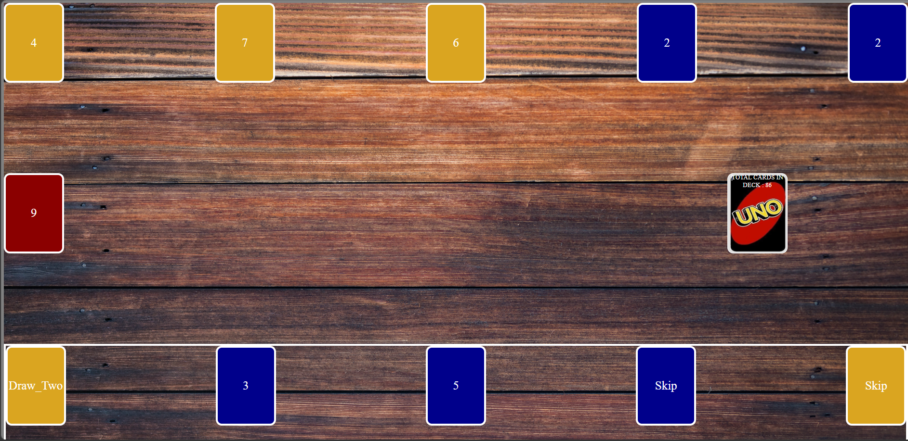
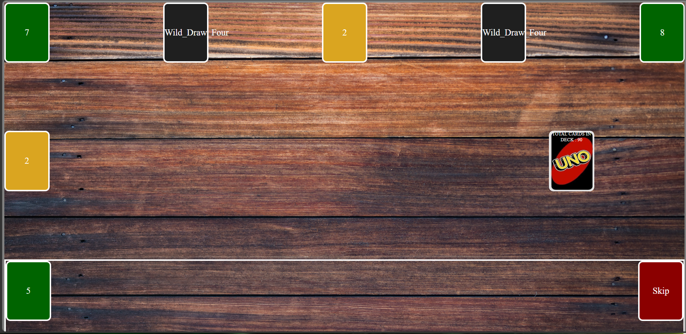

# Project Name : UNO Card Game

## Technologies Used
- HTML
- CSS
- JavaScript

## Description
The game begin with shuffling the deck, then distributing 7 cards on each player hands. Next, each player plays one card from their hand each turn. However, based on the played card some card will have specific effects; for instance:
- Draw_Two : will force the opponent to draw 2 new card
- Skip : will skip the opponent turn
- reverse : will reverse the order of players turn
- Wild_Draw_Four: will force the opponent to draw 4 cards, then change the color of the cards pool to different color randomly
- Wild : will change the color of the cards pool to different color randomly

If the player did not have a card matching the rules for the pool, then he is forced to draw one card, after that if he did not have any playable card his turn will be skipped automatically.

The player will be declared victorious by playing every card in their hand and his hand reaches ZERO card.

## User Story

1. user should be able to draw 7 cards
2. user should be able to play a card in his/her hand 
3. user should be able to win the game when his cards on his hand become zero
4. user should not be able to pick up a card from their opponent hand
5. user should not be able to play a card which does not match the card in the pool based on their number and color except the wild cards (black cards)

## Screenshots

## Future Enhancements
- make the opponent hand invisible to the player
- give AI abitliy to the opponent if the player starts the game
- the ability to make the game playable by multiple players

## Credits
